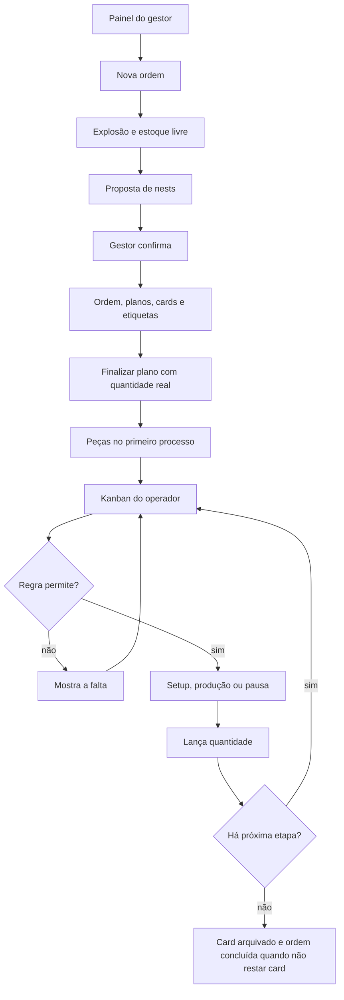

# Fluxo do App — AISA

> Como o usuário se move pelo produto.
> Fonte: [x] Entrevista com usuário  [x] Leitura de código existente (SIGPRO Kanban)
> Depende de: [PRD](PRD.md)

**Data**: 21/10/2026
**Responsável**: a definir (entrevista desta data; nome não informado)

## 1. Perfis de usuário

| Perfil | Descrição | Permissões principais |
|---|---|---|
| Gestor | Conduz a produção e configura a fábrica. Cai no painel. | Todas as telas: painel, ordens, planos de corte, kanban, serviço avulso, saídas, estoque mínimo, estoque, inventário, matéria-prima, etiquetas, relatórios, cadastros, importação e exportação, backup, restauração e senha. |
| Operador | Executa a etapa no chão e no celular. Cai no kanban. | Kanban, leitura de etiqueta e puxar serviço. Sem cadastro, sem abrir ordem, sem plano de corte, sem estoque administrativo e sem saídas. |
| Almoxarife | Cuida do que está na prateleira. Cai no estoque. | Estoque por etapa, lançamento manual, inventário de peça e movimentos e contagem de matéria-prima já cadastrada. O cadastro novo de insumo, peça, produto, nest e processo é do gestor. |
| Administrativo | Registra a saída do dia. Cai nas saídas diárias. | Lançar saída e estornar saída. A tela mostra quanto há pronto no último processo, porque a regra recusa saída acima disso. |

Fonte: entrevista (alcance do gestor, tela inicial, celular, exceções) + código (tarefas de cada menu) + PRD (quem cadastra).

Sessão expirada em qualquer perfil volta à tela de login, sem gravar o formulário pela metade. A pessoa entra de novo e segue da lista.

## 2. Jornadas principais

### Jornada: Entrar

Perfil: todos

1. A pessoa informa nome e senha.
2. Senha conferida com o hash. Tentativas repetidas encontram o limite no Redis.
3. O sistema abre a tela inicial do perfil.

Telas envolvidas: login, painel, kanban, estoque ou saídas.
Fluxo de erro: credencial inválida permanece no login, sem dizer qual dos dois campos errou. Sessão expirada no meio de uma ação volta ao login e a ação não grava.

### Jornada: Abrir ordem de produção

Perfil: gestor

1. No painel, escolhe nova ordem de produção.
2. Informa produto, quantidade e, se quiser, número manual e observação. Sem número manual, o sistema gera `OP` + ano + sequência.
3. O sistema explode a necessidade (produto, subconjuntos e peças) e mostra o estoque livre por etapa, da mais adiantada para a menos.
4. A IA pode sugerir nests e repetições. A sugestão aparece como proposta. O gestor edita ou aceita. A gravação ainda não aconteceu.
5. O gestor confirma produto, quantidade, nests e repetições.
6. Numa transação, o sistema cria a ordem, as necessidades, os planos de corte, as reservas do estoque livre, os cards (primeira etapa liberada, as seguintes aguardando) e uma etiqueta por peça da ordem.
7. A ordem fica aberta. O gestor imprime as etiquetas e, em cada plano, a folha para o laser.

Telas envolvidas: painel, nova ordem, detalhe da ordem, etiquetas, impressão do plano.
Fluxo de erro: número de ordem repetido recusa antes de gravar. Produto sem roteiro não gera card daquela peça. OpenRouter indisponível deixa o passo 4 em branco e o gestor escolhe os nests à mão. Fechar a tela antes de confirmar não cria ordem.

### Jornada: Finalizar plano de corte

Perfil: gestor

1. Abre a lista de planos e entra num plano em aberto.
2. Vê o nest, as repetições, a chapa e a quantidade prevista de cada peça (quantidade no nest × repetições).
3. Imprime a folha para o operador do laser.
4. Depois do corte, informa a quantidade real de cada peça. O previsto vem preenchido.
5. Confirma a finalização.
6. Cada peça entra no primeiro processo do roteiro. O card dessa primeira etapa baixa junto, para o estoque não dobrar. A chapa do nest sai do saldo. Sobra e excedente ganham etiqueta. O plano fica finalizado.

Telas envolvidas: planos de corte, detalhe do plano, impressão.
Fluxo de erro: plano já finalizado não finaliza de novo. Peça sem roteiro não entra no estoque. Quantidade real diferente do previsto é aceita: a regra usa o real e calcula excedente sobre a necessidade acumulada da ordem.

### Jornada: Executar etapa no kanban

Perfil: operador. O gestor percorre a mesma jornada se estiver no chão.

1. Abre o kanban, já filtrado nos cards ativos.
2. Lê a etiqueta em qualquer ponto da tela, ou clica no card. O código da etiqueta abre a etapa em aberto mais atrasada daquela peça na ordem. Se todas concluíram, abre a última.
3. Se a regra impedir até uma peça, o card mostra o motivo (peça na etapa anterior, filho da composição ou insumo) e não oferece lançamento. A IA reescreve esse motivo quando responde. Sem IA, o motivo da regra permanece.
4. Com material, o operador inicia o setup. O cronômetro de preparação corre.
5. Encerra o setup e inicia a produção. O tempo de setup fica registrado.
6. Pode pausar, com motivo da lista ou texto livre, e retomar. O tempo parado não entra em setup nem em produção.
7. Informa a quantidade feita e confirma. Pode encerrar o card mesmo abaixo do previsto.
8. A transação confere de novo a disponibilidade, trava as linhas, baixa a etapa anterior ou os filhos da composição, dá entrada na etapa atual, reserva o que a ordem produziu, baixa os insumos da etapa e libera o próximo card da mesma peça na mesma ordem.
9. Na última etapa, ao concluir, o card é arquivado. Quando não resta card aberto, a ordem fica concluída e as reservas ativas encerram.

Telas envolvidas: kanban, card aberto. No celular é o mesmo kanban, com a leitura em destaque e botões grandes para setup, produção, pausa, retomada e lançamento.
Fluxo de erro: quantidade acima do disponível recusa e diz quanto há e onde. Quantidade zero recusa. Card concluído não inicia de novo. Pausa sem motivo recusa. Duas pessoas na mesma peça: a segunda recebe a recusa da regra com o saldo que sobrou depois da primeira. Código desconhecido avisa e permanece no kanban. Sessão expirada volta ao login sem lançar.

### Jornada: Puxar serviço

Perfil: operador. O gestor também.

1. Escolhe o processo da máquina ociosa.
2. O sistema lista peças com saldo livre na etapa anterior desse processo. A primeira etapa do roteiro não aparece: ela depende de plano de corte.
3. Informa a quantidade, até o livre, e uma observação se quiser.
4. Nasce uma ordem `AV` + ano + sequência, com um card liberado, reserva da etapa anterior e etiqueta.

Telas envolvidas: puxar serviço, kanban.
Fluxo de erro: quantidade acima do livre recusa e informa o saldo. A execução depois segue a jornada do kanban.

### Jornada: Contar e movimentar estoque

Perfil: almoxarife. O gestor também.

1. Abre o estoque e vê, por peça e por etapa, físico, reservado e livre.
2. Para um acerto pontual, lança entrada ou saída na etapa, com observação. A saída não passa do físico.
3. No inventário, informa o que contou na prateleira. O sistema grava só a diferença e o texto do que o sistema tinha e do que foi contado.
4. Na matéria-prima, vê o saldo, lança entrada ou saída e conta chapa, parafuso, embalagem e demais insumos já cadastrados.

Telas envolvidas: estoque, inventário, matéria-prima.
Fluxo de erro: saída maior que o saldo recusa. Contagem igual ao sistema não gera movimento. Criar insumo, peça ou mínimo novo não está nesta jornada; o almoxarife pede ao gestor.

### Jornada: Registrar saída diária

Perfil: administrativo. O gestor também.

1. Abre saídas diárias.
2. Informa peça, quantidade, data e observação. Não há cliente, pedido nem nota.
3. A baixa sai do último processo do roteiro, onde a peça está pronta.
4. Para desfazer, estorna: o movimento inverso entra e a linha da saída sai.

Telas envolvidas: saídas diárias.
Fluxo de erro: peça sem roteiro recusa. Quantidade maior que o pronto recusa e diz quanto há e em qual processo. Quantidade zero recusa.

### Jornada: Acompanhar mínimo e relatórios

Perfil: gestor

1. No painel, vê ordens abertas, cards esperando, em andamento, parados, cortes pendentes, etiquetas a imprimir e até seis itens abaixo do mínimo.
2. No estoque mínimo, compara pronto e previsto (pronto + o que as ordens abertas ainda entregam) com o mínimo. Abaixo de 100% é urgente. Abaixo de 150% é médio. Acima é aceitável.
3. A IA explica a sugestão de mínimo. O número é a média diária de saídas × 15. O gestor grava se aceitar.
4. Nos relatórios, consulta inventário, cronoanálise, paradas, chapas, ordens e a rastreabilidade de cada movimento. Exporta CSV.

Telas envolvidas: painel, estoque mínimo, relatórios.
Fluxo de erro: item sem mínimo fica marcado como sem mínimo, sem cor de urgência. Falha da IA mantém a tabela e a conta.

### Jornada: Cadastrar a fábrica

Perfil: gestor

1. Mantém processos e ícones, componentes, roteiro, composição, produtos, nests ligados ao produto e insumos.
2. Sobe foto de peça e de nest para o volume de arquivos.
3. Na importação, envia CSV separado por ponto e vírgula. A IA propõe peças, roteiro e composição. O gestor revisa e confirma. Código de peça repetido é ignorado.
4. Exporta componentes, produtos, vendas, matéria-prima, estoque e roteiros.
5. Dispara backup, restaura um backup anterior ou troca a própria senha. A restauração pede confirmação. A senha nova tem pelo menos 4 caracteres, como no SIGPRO.

Telas envolvidas: componentes, produtos, nests, matéria-prima, processos, importar e exportar, backup e senha.
Fluxo de erro: CSV sem código ou sem nome pula a linha. Composição circular para na explosão no nível 10, como no SIGPRO. Restauração sem arquivo escolhido não troca o banco.

### Jornada: Perguntar à IA

Perfil: qualquer um, limitado ao que esse perfil já pode ver

1. A pessoa escreve a pergunta, por exemplo o que está parado e por quê.
2. O sistema consulta só leituras permitidas àquele perfil e envia o resumo ao OpenRouter.
3. A resposta volta em texto. Nenhum movimento é criado.

Telas envolvidas: a tela em que a pessoa já está, com o campo de pergunta.
Fluxo de erro: OpenRouter fora ou lento avisa e não inventa saldo. Pedido que exigiria gravar estoque, card ou plano não tem ação correspondente.

## 3. Diagrama

Jornada de uma ordem, do pedido do gestor até a ordem concluída:

Leitura no celular usa o mesmo kanban. O código abre o card do passo `kanban`.

## 4. Pontos de decisão

| Momento | Quem decide | O que o sistema faz |
|---|---|---|
| Nests e repetições da ordem | Gestor, podendo aceitar a proposta da IA | Grava só depois da confirmação, pela criação de ordem do domínio |
| Quantidade real do corte | Gestor | Grava o real, não o previsto, e calcula sobra e excedente |
| Lançar quantidade no card | Operador | Recusa se faltar peça, filho ou insumo, e explica a falta |
| Encerrar card abaixo do previsto | Operador | Conclui o card e registra o parcial |
| Pausa | Operador | Exige motivo |
| Estoque mínimo sugerido | Gestor | A conta é fixa; a gravação é do gestor |
| Importação e roteiro propostos | Gestor | Linha repetida é ignorada; o resto só entra confirmado |
| Contagem de inventário | Almoxarife | Grava a diferença |
| Saída diária | Administrativo | Recusa acima do pronto |
| Restaurar backup | Gestor | Só com confirmação |
| Pergunta à IA | Qualquer perfil | Resposta sem escrita |
